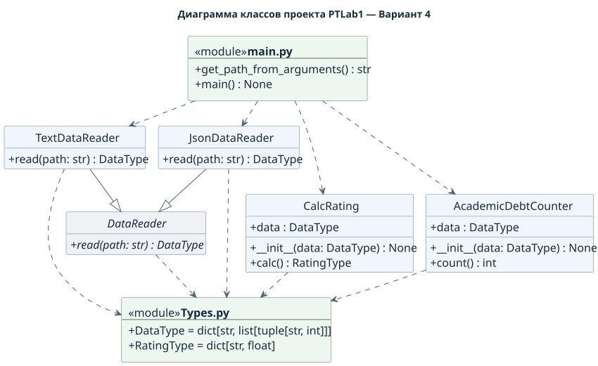
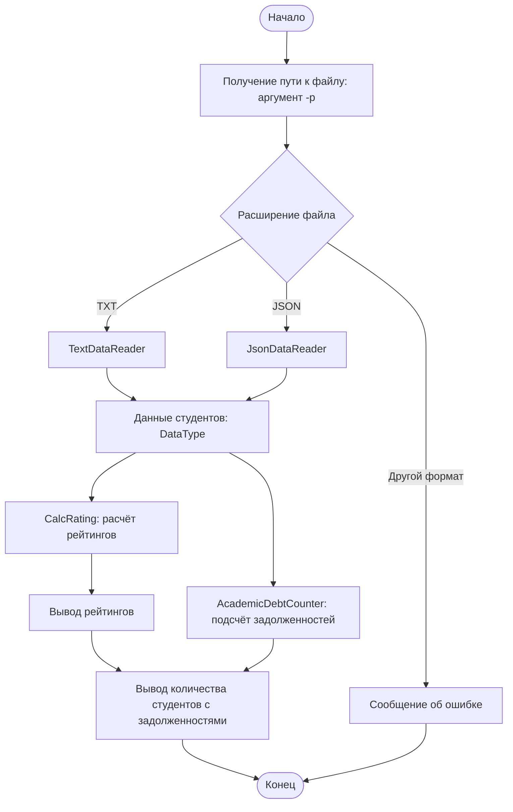

# Лабораторная работа № 1 — Вариант 4

[](https://github.com/shadowmajid10/PTLab1/actions/workflows/github-actions-testing.yml)
[](https://www.python.org/)
[](LICENSE)

**Дисциплина:** Технологии программирования  
**Тема:** Знакомство с системой контроля версий Git и инструментом CI/CD GitHub Actions  
**Выполнил:** Аларадж Заиналабедин  
**Группа:** САПР-1.3  
**Вариант:** 4  
**Репозиторий:** [shadowmajid10/PTLab1](https://github.com/shadowmajid10/PTLab1)

## 1. Цель работы

Изучить принципы работы распределённой системы контроля версий Git и непрерывной интеграции (CI), получить практические навыки разработки объектно-ориентированных программ на Python, модульного тестирования, работы с ветками и автоматизированной проверки программного кода с помощью GitHub Actions.

## 2. Постановка задачи

Необходимо разработать консольное приложение для чтения сведений об успеваемости студентов и вычисления их среднего рейтинга. В рамках индивидуального задания требуется расширить функциональность приложения, реализовать модульные тесты для новых компонентов и выполнить интеграцию изменений в основную ветку после успешного тестирования.

### Индивидуальное задание — вариант 4

| Часть задания | Требование |
|---|---|
| Формат входного файла | JSON |
| Расчётная процедура | Рассчитать и вывести на экран количество студентов, имеющих академические задолженности (имеющих балл менее 61 хотя бы по одному предмету). |

Для выполнения задания реализованы класс `JsonDataReader`, наследующий абстрактный класс `DataReader`, и класс `AcademicDebtCounter`. Поддержка исходного формата TXT сохранена.

## 3. Используемые технологии

| Инструмент | Назначение |
|---|---|
| Python 3.12.10 | Разработка консольного приложения |
| `venv` | Изолированное виртуальное окружение |
| `json` | Чтение и обработка файлов JSON |
| `abc` | Реализация абстрактного базового класса |
| `argparse` | Обработка аргументов командной строки |
| pytest 9.2.0 | Модульное тестирование |
| pycodestyle 2.15.0 | Проверка соответствия PEP 8 |
| Git, GitHub | Управление версиями и хранение исходного кода |
| GitHub Actions | Автоматизированная проверка кода и тестирование |
| PlantUML | Построение UML-диаграммы классов |
| Visual Studio Code | Среда разработки |

Вместо Python 3.10 и Conda, приведённых в методических указаниях, использованы Python 3.12 и стандартный модуль `venv`. Версия Python в CI соответствует основной версии локального окружения (3.12).

## 4. Структура проекта

```text
PTLab1/
├── .github/
│   └── workflows/
│       └── github-actions-testing.yml
├── data/
│   ├── data.txt
│   ├── data.json
│   ├── academic_debt.txt
│   └── academic_debt.json
├── docs/
│   ├── class_diagram.puml
│   └── class_diagram.svg
├── src/
│   ├── __init__.py
│   ├── Types.py
│   ├── DataReader.py
│   ├── TextDataReader.py
│   ├── JsonDataReader.py
│   ├── CalcRating.py
│   ├── AcademicDebtCounter.py
│   └── main.py
├── test/
│   ├── test_CalcRating.py
│   ├── test_TextDataReader.py
│   ├── test_JsonDataReader.py
│   ├── test_AcademicDebtCounter.py
│   └── test_main.py
├── .gitignore
├── LICENSE
├── README.md
└── requirements.txt
```

## 5. Архитектура приложения

| Компонент | Назначение |
|---|---|
| `DataReader` | Абстрактный класс, определяющий метод `read(path)` для чтения данных |
| `TextDataReader` | Чтение текстовых файлов TXT |
| `JsonDataReader` | Чтение JSON и преобразование данных к общему типу `DataType` |
| `CalcRating` | Вычисление среднего балла каждого студента методом `calc()` |
| `AcademicDebtCounter` | Подсчёт студентов с академическими задолженностями методом `count()` |
| `Types.py` | Определение общих типов данных `DataType` и `RatingType` |
| `main.py` | Обработка аргументов, выбор формата чтения, вызов расчётных методов и вывод результатов |

Единое представление входных данных позволяет использовать одни и те же расчётные классы независимо от формата файла:

```python
DataType = dict[str, list[tuple[str, int]]]
RatingType = dict[str, float]
```

### UML-диаграмма классов



[Исходный код диаграммы PlantUML](docs/class_diagram.puml) · [Открыть SVG](docs/class_diagram.svg)

Классы `TextDataReader` и `JsonDataReader` наследуют общий абстрактный класс `DataReader`. Модуль `main.py` использует классы чтения и расчёта. Модуль `Types.py` содержит общие псевдонимы типов. Наследование и зависимости отражены на диаграмме соответствующими UML-обозначениями.

## 6. Форматы входных данных

### TXT

```text
Иванов Иван Иванович
    математика:80
    программирование:90
    литература:76
```

Фамилия, имя и отчество студента записываются без отступа; названия дисциплин и баллы — на строках с отступом.

### JSON

```json
{
    "Иванов Иван Иванович": {
        "математика": 80,
        "программирование": 90,
        "литература": 76
    }
}
```

Класс `JsonDataReader` использует стандартную библиотеку `json`, проверяет структуру входных данных и целочисленный тип оценок. Некорректные структуры и типы оценок вызывают исключение `ValueError`, а синтаксически некорректный JSON — `JSONDecodeError`. Файлы читаются в кодировке UTF-8.

## 7. Алгоритмы работы программы

### 7.1. Расчёт среднего рейтинга

Средний рейтинг студента определяется как среднее арифметическое его баллов по всем дисциплинам:

$$
R_i = \frac{1}{n_i}\sum_{j=1}^{n_i} b_{ij}, \qquad n_i > 0,
$$

где $R_i$ — рейтинг студента, $n_i$ — количество дисциплин, $b_{ij}$ — балл по дисциплине. При отсутствии оценок в данной реализации рейтинг равен `0.0`. Результаты выводятся с двумя знаками после десятичной точки.

### 7.2. Подсчёт академических задолженностей

Студент учитывается в итоговом количестве, если хотя бы один его балл строго меньше 61. Балл 61 не является задолженностью. При наличии нескольких неудовлетворительных оценок один студент учитывается только один раз.

Реализация метода класса `AcademicDebtCounter`:

```python
def count(self) -> int:
    return sum(
        1 for grades in self.data.values()
        if any(grade < 61 for _, grade in grades)
    )
```

Функция `any()` прекращает проверку оценок текущего студента при обнаружении первой задолженности. При пустом наборе данных результат равен нулю; студенты без оценок не учитываются как имеющие задолженность. Исходные данные не изменяются.

В худшем случае временная сложность составляет `O(N + M)`, где `N` — число студентов, а `M` — общее количество оценок. Дополнительная память для подсчёта — `O(1)`.

### 7.3. Общая последовательность выполнения



## 8. Установка и запуск

Требуются Python 3.12 и Git. Команды выполняются из корневой директории проекта.

### Клонирование репозитория

```bash
git clone https://github.com/shadowmajid10/PTLab1.git
cd PTLab1
```

### Создание виртуального окружения (Windows PowerShell)

```powershell
python -m venv .venv
.\.venv\Scripts\Activate.ps1
python -m pip install -r requirements.txt
```

### Создание виртуального окружения (Linux / macOS)

```bash
python3.12 -m venv .venv
source .venv/bin/activate
python -m pip install -r requirements.txt
```

### Запуск приложения

```bash
python -m src.main -p data/data.txt
python -m src.main -p data/data.json
python -m src.main -p data/academic_debt.txt
python -m src.main -p data/academic_debt.json
```

Аргумент `-p` обязателен и задаёт путь к входному файлу. Формат определяется по расширению файла без учёта регистра. Неподдерживаемое расширение приводит к сообщению об ошибке.

## 9. Результаты выполнения

Пример запуска индивидуального задания:

```bash
python -m src.main -p data/academic_debt.json
```

Результат (рейтинги и итоговый показатель):

```text
Иванов Иван Иванович: 82.00
Петров Петр Петрович: 83.67
Сидоров Алексей Сергеевич: 95.00
Смирнова Анна Андреевна: 70.00
Кузнецов Дмитрий Олегович: 78.33
Попова Мария Сергеевна: 60.00
Количество студентов с академическими задолженностями: 2
```

Кузнецов имеет оценку 60, а Попова — оценки 40 и 50. Поэтому задолженности имеются у двух студентов, несмотря на наличие трёх неудовлетворительных оценок в совокупности. Петров с оценкой 61 по одной из дисциплин не учитывается как имеющий задолженность.

| Входной файл | Студентов | Студентов с задолженностями |
|---|---:|---:|
| `data/data.txt` | 4 | 0 |
| `data/data.json` | 4 | 0 |
| `data/academic_debt.txt` | 6 | 2 |
| `data/academic_debt.json` | 6 | 2 |

Результаты для эквивалентных файлов TXT и JSON совпадают.

## 10. Модульное тестирование

Тесты реализованы с помощью библиотеки pytest. Проверяются корректность чтения файлов, вычисление рейтингов, подсчёт задолженностей, обработка аргументов командной строки, граничные случаи, пустые данные, повторные вызовы и обработка некорректных входных данных.

| Файл | Количество тестовых случаев |
|---|---:|
| `test_AcademicDebtCounter.py` | 13 |
| `test_CalcRating.py` | 9 |
| `test_JsonDataReader.py` | 22 |
| `test_TextDataReader.py` | 7 |
| `test_main.py` | 14 |
| **Всего** | **65** |

Особое внимание уделено граничным значениям 60 и 61, нескольким задолженностям у одного студента и совпадению результатов для двух форматов файлов.

### Проверка стиля кода

```bash
python -m pycodestyle src test
```

Нарушений PEP 8 не обнаружено (код завершения 0).

### Запуск тестов

```bash
python -m pytest test -v
```

Результат локального запуска после слияния веток:

```text
65 passed in 0.86s
```

Все 65 тестовых случаев успешно выполнены. Доля успешно пройденных тестов составляет 100%; показатель покрытия строк кода отдельно не измерялся.

## 11. Непрерывная интеграция с GitHub Actions

Конфигурация автоматизированной проверки расположена в файле [github-actions-testing.yml](.github/workflows/github-actions-testing.yml).

Workflow запускается при отправке изменений в любую ветку (`push`), при создании или обновлении pull request в `main`, а также вручную (`workflow_dispatch`).

Этапы выполнения CI:

1. Получение исходного кода репозитория на `ubuntu-latest`.
2. Настройка Python 3.12.
3. Установка зависимостей из `requirements.txt`.
4. Проверка стиля с помощью pycodestyle.
5. Запуск модульных тестов с помощью pytest.

При ненулевом коде завершения проверки стиля или тестирования соответствующее задание CI завершается ошибкой. В проекте реализована непрерывная интеграция; автоматическое развёртывание приложения не предусмотрено.

### Демонстрация обнаружения ошибки

Для проверки работы CI в тесте `test_averages_minimum_and_maximum_grades` файла `test/test_CalcRating.py` ожидаемое среднее значение было намеренно изменено с `50.0` на `51.0`. GitHub Actions зафиксировал ошибку. После восстановления корректного значения тесты снова прошли успешно.

| Этап | Коммит | Результат CI |
|---|---|---|
| Настройка CI | [`c043ebb`](https://github.com/shadowmajid10/PTLab1/commit/c043ebb) | Успешно |
| Внесение намеренной ошибки | [`4f6ee58`](https://github.com/shadowmajid10/PTLab1/commit/4f6ee58) | Ошибка |
| Исправление ошибки | [`f501fb4`](https://github.com/shadowmajid10/PTLab1/commit/f501fb4) | Успешно |

История изменений и результаты автоматизированных проверок доступны в разделе [GitHub Actions](https://github.com/shadowmajid10/PTLab1/actions).

## 12. Работа с ветками Git

Для каждой части индивидуального задания была создана отдельная ветка на основе `main`. Изменения интегрированы в основную ветку после успешного выполнения тестов и автоматизированных проверок.

| Ветка | Реализованная функциональность | Коммит реализации | Коммит слияния |
|---|---|---|---|
| `feature/json-reader` | Чтение JSON и соответствующие тесты | [`5628593`](https://github.com/shadowmajid10/PTLab1/commit/5628593) | [`0d0723a`](https://github.com/shadowmajid10/PTLab1/commit/0d0723a) |
| `feature/academic-debt` | Подсчёт задолженностей и соответствующие тесты | [`5c37483`](https://github.com/shadowmajid10/PTLab1/commit/5c37483) | [`a4ef591`](https://github.com/shadowmajid10/PTLab1/commit/a4ef591) |

Первое слияние выполнено с использованием `git merge --no-ff`, второе — через [Pull Request № 2](https://github.com/shadowmajid10/PTLab1/pull/2).

История разработки до завершения программной части:

```text
*   a4ef591 Merge pull request #2 (academic-debt)
|\
| * 5c37483 Implement academic debt counter for variant 4
|/
*   0d0723a Merge JSON data reader for variant 4
|\
| * 5628593 Implement JSON data reader for variant 4
|/
* f501fb4 Fix intentional test failure and restore CI
* 4f6ee58 Introduce intentional test failure to demonstrate CI
* c043ebb Configure GitHub Actions CI pipeline
* 5ed3a88 Implement basic student rating calculator and unit tests
```

Для просмотра актуальной истории используется команда:

```bash
git log --graph --oneline --all --decorate
```

## 13. Лицензия и исключаемые файлы

Проект содержит файл [LICENSE](LICENSE) с текстом лицензии MIT. Лицензия разрешает использование, изменение и распространение программного обеспечения при сохранении уведомления об авторских правах и текста разрешения.

Файл [.gitignore](.gitignore) исключает из системы контроля версий виртуальные окружения, кэш Python и pytest, файлы покрытия, настройки IDE, файлы переменных окружения и временные системные файлы.

## 14. Выводы

В ходе лабораторной работы разработано объектно-ориентированное консольное приложение для анализа успеваемости студентов. Реализована поддержка форматов TXT и JSON, вычисление среднего рейтинга и подсчёт количества студентов с академическими задолженностями в соответствии с вариантом 4.

Получены практические навыки работы с Git, создания и слияния веток, разработки модульных тестов и настройки непрерывной интеграции с помощью GitHub Actions. Эксперимент с намеренной ошибкой подтвердил способность CI обнаруживать сбои в тестах и фиксировать восстановление работоспособности после исправления.

После интеграции обеих частей индивидуального задания успешно выполнены все 65 локальных тестов, нарушений PEP 8 не обнаружено. Подготовлены UML-диаграмма классов, документация проекта и лицензия MIT.

## 15. Использованные источники

1. Методические указания к лабораторной работе № 1 «Знакомство с системой контроля версий Git и инструментом CI/CD GitHub Actions», 2022, с. 1–13.
2. [Документация Python 3.12](https://docs.python.org/3.12/).
3. [Документация модуля json](https://docs.python.org/3.12/library/json.html).
4. [Официальная документация Git](https://git-scm.com/docs).
5. [Официальная документация pytest](https://docs.pytest.org/en/stable/).
6. [PEP 8 — Style Guide for Python Code](https://peps.python.org/pep-0008/).
7. [Документация GitHub Actions](https://docs.github.com/en/actions).
8. [PlantUML — диаграммы классов](https://plantuml.com/class-diagram).
9. [MIT License — Open Source Initiative](https://opensource.org/license/mit).
